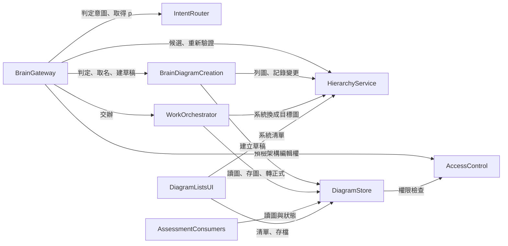

# Components — 讓大腦直接建立新的架構圖（修訂 1）

> 來源：`inception/requirements-analysis/requirements.md`（修訂 2，已核可）；本站作答 `domain-design-questions.md` 的 Q1=B、Q2=A、Q4=A、Q5=B、Q6=A（Q6=A 取代 Q3=A）。
> **修訂 1（2026-11-17）**：依 `reviews/review-01.md` 對照實際程式修正元件責任——草稿改由閘道在交辦前建立（Q6=A）、專案頁清單與計數改歸架構圖 API 與前端、權限預檢由閘道以 `user_can_arch` 執行、變更紀錄屬性對齊模型、補上 `UserAccounts` 與 `AccessControl` 兩個既有元件。
> 這是 brownfield 改動：除了新元件 `BrainDiagramCreation`，其餘都是既有元件，`behaviour` 只寫**本 intent 帶來的改變**。實體只寫到「誰擁有、識別碼、屬性名」的深度，型別與允許值留給 contract-design。

## Part A — 元件目錄（機讀）

```yaml
components:
  - name: BrainGateway
    summary: 既有的大腦 WebSocket 閘道；本 intent 在交辦前完成新建草稿、切換作業對象與各種反問
    behaviour: >
      收到一句話後交給 IntentRouter 判定，取得意圖與「是否要新的一張」的機率 p；再以 BrainDiagramCreation 的純函式決定「新建、修改或反問」（含 FR6.3a 的優先序）。
      判定為新建時，先以 AccessControl 的 user_can_arch(edit) 預檢架構編輯權（與建圖端點同一個判斷），沒有就回覆需要架構編輯權並請向平台管理者申請角色變更，不交辦（FR4.1）。
      有權限時請 BrainDiagramCreation 以使用者 token 建立草稿，成功後以既有的 _set_target_confirmed（backend/services/brain_gateway.py:1592）把作業對象切到這張草稿並扇出，再照既有流程交辦給 WorkOrchestrator（Q6=A、FR1.3）。
      因為建草稿發生在交辦之前、而工作編排不建圖，一個工作項不可能建出第二張圖（FR1.4 的目的）；若建草稿成功但切換前斷線或當機，系統下會留一張草稿，使用者下次說要畫圖時依 FR6.3a 反問「接著畫或新建」，不會默默多一張。
      作業對象是系統且系統下有多張圖、而使用者要修改時，在交辦前反問要改哪一張（FR3.2），不再交給工作編排去直接失敗。
      需要反問時送出新增的線上反問種類，候選帶系統或圖的識別碼（Q1=B）；原始請求與候選存在連線上的待決反問，斷線即失效。
      點選時先確認選的是本次提供的候選之一（沿用 brain_gateway.py:1672 的檢查），再經 HierarchyService 重新驗證該系統或圖仍存在、使用者仍擁有（FR3.5），不符就說明並重新列出候選。
      候選依最近更新時間由新到舊、再依識別碼排序，超過上限只列前若干筆並請使用者改用「切換對象」（FR3.6）。
    responsibilities:
      - 新建前的權限預檢
      - 交辦前建立草稿並切換作業對象
      - 可點選反問的種類、候選、排序、保存與點選後重新驗證
    depends_on:
      - component: IntentRouter
        interaction: 判定意圖並取得「是否要新的一張」的機率 p
        style: sync
      - component: BrainDiagramCreation
        interaction: 決定新建、修改或反問；建立草稿與取名
        style: sync
      - component: AccessControl
        interaction: 以 user_can_arch(edit) 預檢架構編輯權
        style: sync
      - component: HierarchyService
        interaction: 列出使用者擁有的系統與系統下的圖（含草稿）作為候選；點選時重新驗證
        style: sync
      - component: WorkOrchestrator
        interaction: 把作業對象已確定的請求交辦為工作項
        style: sync
    dependents: []
    external_dependencies:
      - name: Redis
        kind: cache
        purpose: session 的作業對象（_set_target_confirmed → store.set_work_target）
    entities:
      - name: PendingClarify
        identifier: turnId
        attributes: [kind, candidateIds, candidateTargets, decision, originalUtterance]
        references:
          - entity: UserDiagram
            owned_by: DiagramStore
            relationship: 候選可以指向一張圖（含草稿）
          - entity: System
            owned_by: HierarchyService
            relationship: 候選可以指向一個系統

  - name: IntentRouter
    summary: 既有的意圖路由（Jev 1.14 Decisions API）；本 intent 在同一次請求多問一題
    behaviour: >
      在既有的同一次 Decisions 請求中多問一題「是否要一張新的圖」，回傳機率 p，不另發模型呼叫（FR2.2、NFR2）。
      p 只是輸入；「新建、修改或反問」由 BrainDiagramCreation 的純函式決定。路由觀測事件加上判定結果的類別，不含原文與圖名（NFR4）。
    responsibilities:
      - 取得「是否要新的一張」的機率
    depends_on: []
    dependents:
      - component: BrainGateway
        interaction: 判定意圖並取得機率 p
    external_dependencies:
      - name: OpenRouter Decisions API
        kind: third-party-api
        purpose: 意圖與「是否要新的一張」的判定
    entities: []

  - name: BrainDiagramCreation
    summary: 新元件：決定新建或修改、為新圖取名、以使用者 token 建立草稿（Q5=B）
    behaviour: >
      依 team.md 的三層形狀拆成兩個模組：
      (1) 純函式模組——新建或修改的判定（requirements FR2.2 判定表，門檻 t 取自信心門檻設定，含 FR6.3a 的優先序）與新圖取名（FR5），
      不讀 DB、不連外、不 import httpx／DB session／HTTPException，以 property-based 測試鎖住（ADR-0006 agent routing hard constraint）；
      (2) I/O 模組——以使用者 token 經既有建圖端點建立草稿（沿用 work_orchestrator_capabilities.CapabilityClient 的同行程 ASGI 呼叫形狀，新增建圖呼叫），
      建立前經 HierarchyService 列出系統下的圖（含草稿）以判斷重名與未完成草稿；建立後經 HierarchyService 記一筆「經大腦建立」（FR7.1）。
      本元件不設定作業對象（那是 BrainGateway 的責任）。
    responsibilities:
      - 新建或修改的判定（純函式）
      - 新圖取名（純函式）
      - 以使用者 token 建立草稿並記錄變更
    depends_on:
      - component: DiagramStore
        interaction: 以使用者 token 經建圖端點建立草稿
        style: sync
      - component: HierarchyService
        interaction: 列出系統下的圖（含草稿）；記錄「經大腦建立」
        style: sync
    dependents:
      - component: BrainGateway
        interaction: 判定、取名、建立草稿
    external_dependencies: []
    entities: []

  - name: WorkOrchestrator
    summary: 既有的工作編排；本 intent 只改「產圖成功時轉為正式」，不建圖
    behaviour: >
      交辦進來時作業對象已是一張圖（新建的草稿或既有的圖），照既有的「讀圖 → 產圖 → 存圖」執行，不建圖（Q6=A）。
      產圖並存檔成功時以「轉為正式」的方式存檔（FR6.2）；產圖失敗則保留草稿、工作項標失敗並說明原因（FR6.3）。
      既有以 HierarchyService.list_diagrams_of_system（work_orchestrator.py:967）把「只選到系統」換成目標圖的呼叫，改為明示包含草稿（Q4=A）。
    responsibilities:
      - 產圖成功時轉為正式
    depends_on:
      - component: DiagramStore
        interaction: 讀圖、存圖（含轉為正式），經 CapabilityClient 以使用者 token 呼叫
        style: sync
      - component: HierarchyService
        interaction: 系統換成目標圖（明示包含草稿）
        style: sync
    dependents:
      - component: BrainGateway
        interaction: 交辦作業對象已確定的請求
    external_dependencies:
      - name: Redis
        kind: cache
        purpose: 工作項的保存
    entities:
      - name: WorkItem
        identifier: workItemId
        attributes: [status, capability, dispatchStage, sideEffect]
        references:
          - entity: UserDiagram
            owned_by: DiagramStore
            relationship: 工作項處理的對象是一張圖

  - name: DiagramStore
    summary: 既有的架構圖資料與 API（collab_router）；本 intent 新增草稿狀態、轉為正式與草稿在清單中的呈現
    behaviour: >
      架構圖新增狀態（草稿／正式），由本元件擁有（Q2=A）；既有資料庫經 hierarchy_migration._ensure_hierarchy_schema() 補欄位，既有的圖一律為正式（FR6.5）。
      建圖可指定建立為草稿；建圖仍要求架構編輯權（AccessControl 的 require_arch_action("edit")），並沿用設定「最後開啟的圖」的副作用（FR1.3a）。
      存檔要能區分「手動存檔，轉為正式」與「自動存檔、評核前寫回，只寫內容」，後兩者不改狀態（FR6.2）。
      「我的架構圖」清單（GET /api/collab/diagrams，collab_router.py:344）回傳每張圖的狀態，供前端標示草稿並自行排除於計數（FR6.4、FR6.4a）。
      分享不得分享草稿（FR6.4a）。
    responsibilities:
      - 架構圖的內容、狀態與存檔語意
      - 清單回傳狀態
      - 分享對草稿的排除
    depends_on:
      - component: AccessControl
        interaction: 建圖與存檔的架構權限檢查
        style: sync
    dependents:
      - component: BrainDiagramCreation
        interaction: 建立草稿
      - component: WorkOrchestrator
        interaction: 讀圖、存圖
      - component: AssessmentConsumers
        interaction: 讀圖時得知狀態以拒絕草稿
      - component: DiagramListsUI
        interaction: 清單、手動存檔與自動存檔
    external_dependencies:
      - name: PostgreSQL
        kind: database
        purpose: user_diagrams 與分享關聯
    entities:
      - name: UserDiagram
        identifier: id
        attributes: [userId, title, xmlData, systemId, status, updatedAt]
        references:
          - entity: System
            owned_by: HierarchyService
            relationship: 每張圖至多掛在一個系統下

  - name: HierarchyService
    summary: 既有的專案／系統階層；本 intent 讓列圖的呼叫端明示含不含草稿，並記錄「經大腦建立」
    behaviour: >
      list_diagrams_of_system 加一個必填、沒有預設值的參數表明是否包含草稿（Q4=A、FR6.4c）；現行呼叫端（WorkOrchestrator）與新呼叫端（BrainGateway 候選、BrainDiagramCreation 重名判斷）皆包含草稿。
      刪除系統的檢查（hierarchy_service.py:212 起）是直接查詢，必須包含草稿（FR6.4b）。
      記錄「經大腦建立」的變更：沿用 source=brain_orchestration（schema_rbac.sql:425），以 requirementSummary 表示「經大腦建立」，actorUserId 為使用者（FR7.1）；確切文字由 contract-design 定案。
    responsibilities:
      - 列圖時含不含草稿的明示
      - 刪除系統時計入草稿
      - 「經大腦建立」的變更紀錄
      - 系統與圖的存在與擁有權驗證
    depends_on: []
    dependents:
      - component: BrainGateway
        interaction: 列出系統與圖作為候選、點選時重新驗證
      - component: BrainDiagramCreation
        interaction: 列圖與記錄變更
      - component: WorkOrchestrator
        interaction: 系統換成目標圖
      - component: DiagramListsUI
        interaction: 專案頁的系統清單
    external_dependencies:
      - name: PostgreSQL
        kind: database
        purpose: projects、systems、diagram_change_records
    entities:
      - name: System
        identifier: id
        attributes: [projectId, name, isDefault]
      - name: DiagramChangeRecord
        identifier: id
        attributes: [diagramId, source, actorUserId, requirementSummary, requirementLabel, createdAt]
        references:
          - entity: UserDiagram
            owned_by: DiagramStore
            relationship: 每筆變更屬於一張圖

  - name: UserAccounts
    summary: 既有的使用者管理（user_router）；本 intent 讓兩處「底下有沒有圖」的判斷計入草稿
    behaviour: >
      清除空的預設專案的判斷（backend/services/user_router.py:438 起）與刪除使用者時的擁有圖檢查（:651 起）都是直接查詢 user_diagrams，必須包含草稿（FR6.4b），
      否則會清除仍有草稿的預設專案，或在使用者仍擁有草稿時誤判可刪。
    responsibilities:
      - 預設專案清除與使用者刪除時計入草稿
    depends_on: []
    dependents: []
    external_dependencies:
      - name: PostgreSQL
        kind: database
        purpose: users、projects、user_diagrams
    entities: []

  - name: AccessControl
    summary: 既有的權限檢查（rbac.py）；本 intent 不改規則，只多一個呼叫端
    behaviour: >
      user_can_arch(db, role, action, authorization_status) 是架構權限的唯一判斷；建圖端點經 require_arch_action("edit")（rbac.py:198）使用它，
      BrainGateway 的新建預檢直接呼叫同一個函式，兩處不各寫一份（team.md 單一真實來源）。
    responsibilities:
      - 架構權限的判斷
    depends_on: []
    dependents:
      - component: BrainGateway
        interaction: 新建前預檢架構編輯權
      - component: DiagramStore
        interaction: 建圖與存檔的權限檢查
    external_dependencies:
      - name: PostgreSQL
        kind: database
        purpose: role_permissions
    entities: []

  - name: AssessmentConsumers
    summary: 既有的評核（review_router／review_orchestrator）、WA 共編（wa_collab_orchestrator）與估價綁圖（cost/estimate_intake_router）；本 intent 讓它們拒絕草稿
    behaviour: >
      以草稿為對象時一律不執行，回覆「這張圖還是草稿，請先完成產圖」，資料不變（FR6.4a）。大腦交辦評核或估價時，由這些既有端點回錯，工作項以該訊息結束。
    responsibilities:
      - 評核、WA 共編與估價綁圖對草稿的拒絕
    depends_on:
      - component: DiagramStore
        interaction: 讀取圖與其狀態
        style: sync
    dependents: []
    external_dependencies: []
    entities: []

  - name: DiagramListsUI
    summary: 既有前端（專案頁 OverviewTab／SystemDiagrams、工作區歷史清單、切換對象選單、工作區存檔）；本 intent 顯示草稿並區分手動存檔
    behaviour: >
      三種清單以「草稿」標示草稿（FR6.4）。專案頁「架構圖」計數由前端自行計算（OverviewTab.tsx 的 attachedCount，資料來自 GET /api/collab/diagrams），改為不計草稿（FR6.4a）。
      工作區「儲存架構圖」按鈕以「轉為正式」存檔；自動存檔（WorkspacePage.tsx:269-286）與評核前寫回（:500）只寫內容（FR6.2）。
      呈現 BrainGateway 新增的可點選反問種類（Q1=B）。
    responsibilities:
      - 草稿標示與計數排除
      - 手動存檔與自動存檔的區分
      - 新反問種類的呈現
    depends_on:
      - component: DiagramStore
        interaction: 我的架構圖清單（含狀態）、存檔
        style: sync
      - component: HierarchyService
        interaction: 專案頁的系統清單
        style: sync
    dependents: []
    external_dependencies: []
    entities: []
```

## Part B — 人讀版本

### Component Diagram



文字版：BrainGateway 呼叫 IntentRouter、BrainDiagramCreation、AccessControl、HierarchyService、WorkOrchestrator；BrainDiagramCreation 呼叫 DiagramStore 與 HierarchyService；WorkOrchestrator 呼叫 DiagramStore 與 HierarchyService；DiagramStore 呼叫 AccessControl；AssessmentConsumers 呼叫 DiagramStore；DiagramListsUI 呼叫 DiagramStore 與 HierarchyService；UserAccounts 不呼叫目錄內其他元件。

### Component Summary

| Component | Purpose | Depends On | Dependents | Entities Owned |
|---|---|---|---|---|
| BrainGateway | 權限預檢、交辦前建草稿並切換對象、反問 | IntentRouter、BrainDiagramCreation、AccessControl、HierarchyService、WorkOrchestrator | — | PendingClarify |
| IntentRouter | 同一次請求多問「是否要新的一張」 | — | BrainGateway | — |
| BrainDiagramCreation（新） | 判定、取名（純函式）與建草稿（I/O） | DiagramStore、HierarchyService | BrainGateway | — |
| WorkOrchestrator | 產圖成功時轉為正式 | DiagramStore、HierarchyService | BrainGateway | WorkItem |
| DiagramStore | 草稿狀態、存檔語意、清單回傳狀態 | AccessControl | BrainDiagramCreation、WorkOrchestrator、AssessmentConsumers、DiagramListsUI | UserDiagram |
| HierarchyService | 列圖含不含草稿、刪除系統計入草稿、變更紀錄 | — | BrainGateway、BrainDiagramCreation、WorkOrchestrator、DiagramListsUI | System、DiagramChangeRecord |
| UserAccounts | 預設專案清除與使用者刪除計入草稿 | — | — | — |
| AccessControl | 架構權限的唯一判斷 | — | BrainGateway、DiagramStore | — |
| AssessmentConsumers | 評核、WA 共編、估價拒絕草稿 | DiagramStore | — | — |
| DiagramListsUI | 草稿標示、計數排除、手動存檔 | DiagramStore、HierarchyService | — | — |

### Entity Ownership

| Entity | Owning Component | Identifier | Attributes | References |
|---|---|---|---|---|
| UserDiagram | DiagramStore | id | userId, title, xmlData, systemId, status, updatedAt | System（HierarchyService） |
| WorkItem | WorkOrchestrator | workItemId | status, capability, dispatchStage, sideEffect | UserDiagram（DiagramStore） |
| PendingClarify | BrainGateway | turnId | kind, candidateIds, candidateTargets, decision, originalUtterance | UserDiagram（DiagramStore）、System（HierarchyService） |
| System | HierarchyService | id | projectId, name, isDefault | — |
| DiagramChangeRecord | HierarchyService | id | diagramId, source, actorUserId, requirementSummary, requirementLabel, createdAt | UserDiagram（DiagramStore） |

### External Dependencies

| Component | Dependency | Kind | Purpose |
|---|---|---|---|
| BrainGateway | Redis | cache | session 的作業對象 |
| IntentRouter | OpenRouter Decisions API | third-party-api | 意圖與「是否要新的一張」 |
| WorkOrchestrator | Redis | cache | 工作項 |
| DiagramStore | PostgreSQL | database | user_diagrams、分享 |
| HierarchyService | PostgreSQL | database | projects、systems、diagram_change_records |
| UserAccounts | PostgreSQL | database | users、projects、user_diagrams |
| AccessControl | PostgreSQL | database | role_permissions |

### Rationale

| Component | 為什麼是獨立的建構單元 |
|---|---|
| BrainDiagramCreation | 使用者決定（Q5=B）：判定、取名、建草稿是一組會一起變動的規則；內部拆純函式與 I/O 兩個模組，純函式可單獨以 PBT 驗證 |
| BrainGateway | 既有：唯一能設定作業對象的地方（`_set_target_confirmed`），故建草稿與切換都在交辦前於此完成（Q6=A） |
| IntentRouter | 既有：唯一與模型對話判定意圖的地方；只多一題 |
| WorkOrchestrator | 既有：工作項生命週期；本 intent 只改轉為正式 |
| DiagramStore | 既有：架構圖資料的唯一擁有者；草稿狀態屬於圖本身 |
| HierarchyService | 既有：專案與系統的擁有者；列圖與變更紀錄已在這裡 |
| UserAccounts | 既有：兩處直接查詢 `user_diagrams` 的判斷在這裡，必須計入草稿 |
| AccessControl | 既有：架構權限的唯一判斷，閘道預檢與端點檢查共用 |
| AssessmentConsumers | 三個既有使用端因同一條規則（拒絕草稿）合併描述 |
| DiagramListsUI | 既有前端；專案頁計數在這裡計算 |

**Alternatives Rejected**：判定與建圖不新增元件（Q5 選項 A），見 ADR-001；工作編排建圖並以資料庫冪等鍵保證（Q6 選項 B），見 ADR-008。

## Assumptions & Open Questions

- 留給 contract-design：新反問種類的線上形狀與候選識別碼欄位（FR3.4）、候選筆數上限（OQ2）、名稱截長上限與指令詞清單（OQ1）、空白圖 XML 骨架（OQ5）、存檔「轉為正式」的區分方式（OQ7）、「經大腦建立」的摘要文字（OQ9）、「我的架構圖」清單回傳狀態的欄位（FR6.4）。
- **對已核可需求的設計調整（不回改上游，以本段向下游傳遞）**：
  - FR1.4 寫「工作項記住它建立的圖並在後續步驟沿用」。Q6=A 改由閘道在交辦前建草稿、工作編排不建圖，FR1.4 的目的（一個工作項至多一張圖）由結構保證，不再需要在工作項記圖 id。
  - FR6.4c 寫「`list_diagrams_of_system` 同時供 FR6.4a 與 FR6.4b 使用」。實際上 FR6.4b 的兩處（刪除系統、清除預設專案）是直接查詢，專案頁計數也不經這個方法而是前端計算（`OverviewTab.tsx`）。本設計依實際程式：必填參數只加在列圖方法，直接查詢的兩處另行保證包含草稿，專案頁計數由前端排除草稿。
- 「建草稿成功但切換作業對象前斷線或當機」會留下一張草稿；由 FR6.3a 的反問承接，不另設清除機制。〔推導〕
